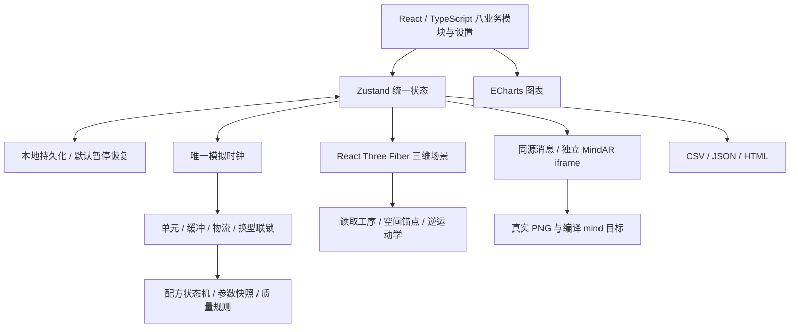
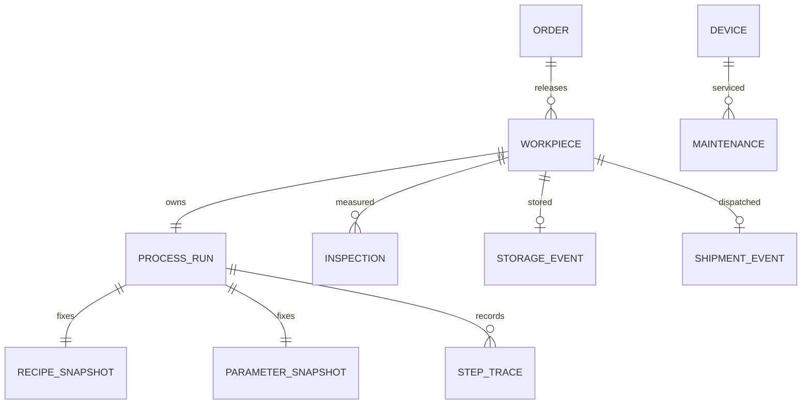
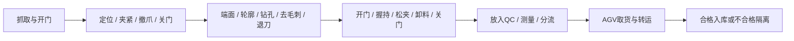

# 初步设计（v1.3）

## 架构与技术理由

React承载交互，TypeScript约束状态，Zustand使页面读同一状态。R3F管理渲染循环，Three主车间版本0.180；MindAR1.2.5使用独立Three0.151.3，避免混用对象。ECharts负责趋势。纯前端便于课程复核，但不提供真实工业控制、多用户权限或长周期数据库。

## 核心数据关系

订单完成量只在合格入库时增加。首检与返工复测分开，工件编号不变；返工前的参数、配方、测量和轨迹归档。旧数据保持原口径，不补造缺失证据。

## 布局与空间设计

两CNC位于x=-2.55、z=±2.2，两机械臂位于x=0、z=±2.2；共享QC位于x=1.7、z=0，仓储位于x=6.3。各设备坐标、取料/夹具/QC/输出点统一在`src/domain/layout.ts`。机械臂两段各1.65场景单位，目标路径经过可达性和交接连续性检查。场景单位未转换为真实车间工程尺寸。

## 工序与所有权

单元配方19阶段：法兰49秒，安装板52秒。两种轮廓和钻孔路径不同，安装板孔位名义30mm、轮廓宽度100mm；法兰孔位名义20mm、直径80mm。规格与时间为课程假设，非产品工程图。

夹爪、夹具、QC和暂存位单独接管工件。门未打开不装卸，夹紧后撤爪，松夹后卸料，QC共享占用，缓冲区满则反压。CNC或机械臂故障暂停该单元并保持原工件。

## 调度、换型与物流

FCFS与紧急优先只重排待加工订单，已夹持件不转移进度。能力配置限定可投料产品，换型6秒。故障可将未开工毛坯经8秒AGV任务送至兼容单元，预留目的缓冲位，到达后才改变设备归属并记录路线。

正常物流14秒，含取货、顶升、载货、堆垛/隔离和返回。为降低原型冲突，物流使用保守独占资源策略，没有声明求得最优路线。仓储480件，按12个逻辑货格聚合；满仓阻塞入库，发运释放容量而不回减历史履约。

预计完工考虑已知剩余工序、换型、共享QC与转运；不能预知新故障、不良或真实人机作业波动。

## 质量与回放

定位偏移同量传递到孔位X；轮廓补偿误差传递到名义尺寸；跳过去毛刺产生0.12mm残留，高于0.05mm允许值。已知输入用于解释规则内因果，不能替代真实现场根因诊断。仅残余毛刺允许去毛刺返工，孔位/尺寸损伤报废补投。

回放读取完成工序的时间区间与快照，使用与实时相同的姿态函数，但不调用生产时钟。停机期间没有逐帧记录，不当作精确运动录像。

## UI、时间与持久化

沿用工业蓝灰品牌，以青/蓝/绿/金作为可选主色。支持深浅色、四档字号、标签、低画质、减少动态与表格密度。数值、图表与操作反馈同步。版本清单只包含版本和说明，不记录更新时间。

唯一时钟每100ms推进，按状态边界切片；指标每10模拟秒采样。写存档前合并运行快照到每秒一次；暂停即时保存。配方去重减少存档体积；恢复默认暂停，事件/设备曲线有界。

## AR 工作原理与边界

自制PNG经MindAR编译器生成真实`.mind`目标；识别成功后锚定简化设备模型，通过同源消息传递设备和维修状态。页面离开或关闭摄像头释放媒体轨道。权限失败可进入明确标注的普通三维维修演示，回退不具备识别功能。手机需HTTPS，真实手机仍待验证。
