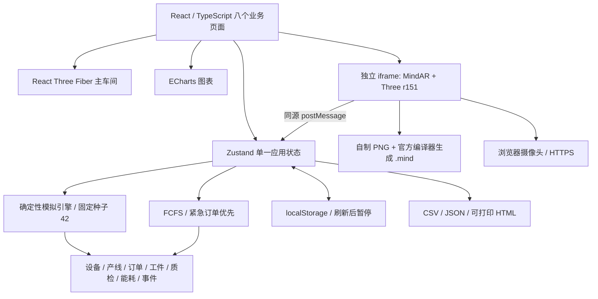
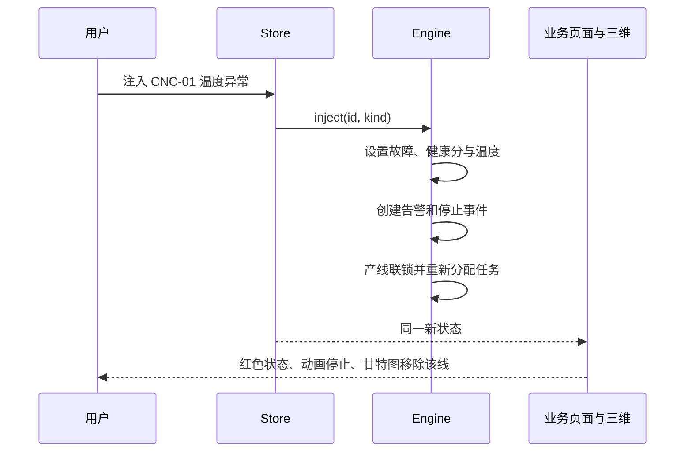

# 初步设计

## 总体架构

AR 向父页面报告识别与摄像头状态。维修步骤在父应用执行应用动作并保存统一事件。父页面同时验证消息 origin 和 iframe source。摄像头画面不上传服务器。

## 功能结构与业务闭环

## 核心数据模型

| 模型 | 核心字段与关系 |
|---|---|
| Device | id、kind、line、status、温度/振动、runtime、power、energy、produced、task、position、history |
| ProductionLine | id、name、deviceIds |
| ProductionOrder | id、product、quantity、completed、priority、created、planned、due、cancelled |
| Workpiece | id、orderId、deviceId、time、batch、result |
| QualityInspection | id、workpieceId、orderId、deviceId、batch、time、result、defect、x/y |
| Alarm | id、deviceId、kind、message、time、resolved |
| MaintenanceWorkOrder | id、deviceId、alarmId、created、completed、steps[3] |
| EnergyRecord | id、time、delta、total、output、good、lineA、lineB |
| SimulationEvent | id、time、type、message、deviceId、orderId |

ID 由统一序列生成，前缀区分对象。事件时间使用从固定起点开始的模拟秒，界面按 Asia/Shanghai 格式化。数据模型的实际 TypeScript 定义见 `src/domain/types.ts`。

## 模拟时钟与事件流

墙钟每一秒触发一次推进，倍率为 1/5/20。引擎内部以 1 个模拟秒的小步进行分配、加工、参数更新和电能积分，避免大步长遗漏工件。暂停直接跳过推进。每 10 模拟秒记录能耗、产量和设备参数。设备参数历史保留 180 点，事件保留 2000 条。

订单、故障、维修、恢复和模式变更都通过同一个 Store 的 update 完成。设备任务变化后生成分配事件。工作件完成时同步生成质检。Zustand persist 保存主要状态，刷新时强制暂停防止后台意外推进。

## 调度模型

- 两台 CNC 是并行加工资源。产品型号不限制可用 CNC，这是一项演示简化。
- 基础节拍为 10 秒/件，当前模式能力倍率为 r。
- 剩余任务时长 = `(订单数量 - 已完成数量) × 10 / r` 秒。
- FCFS 按创建时间排序；紧急优先按 priority（0 最紧急）再按创建时间排序。
- 为每个订单选取最早空闲的可用 CNC。起始时刻为设备空闲时刻与订单计划开始时刻的较大值。
- 一条线的任意配套设备故障/维修会锁住该线的 CNC，整条线不再承担正常任务。
- ETA 大于 due 时标记延期。每次状态改变均重新计算，甘特图和表格共用相同 Slot 数组。
- 采用简化可抢占的剩余件规则，不模拟换型准备、有限缓冲、多工序工艺路线或最优解。

## 指标口径

| 指标 | 计算定义 |
|---|---|
| 产量 | 所选设备中 CNC 的 produced 之和，包含不合格品 |
| 今日计划 | 当前未取消订单数量总和；当前课程日期固定 |
| 设备运行率 | running 设备数 / 所选全部设备数 |
| 订单完成率 | 未取消且已完成订单数 / 未取消订单数；无订单显示 0 |
| 检测良品率 | 合格检测数 / 总检测数，无检测显示缺失符号 |
| OEE 可用率 A | CNC 累计实际加工秒 / (模拟运行秒 × CNC 数量)；待机、故障和维修均降低该口径 |
| OEE 性能 P | CNC 产出 / 实际加工时间内按当时模式累计的理论产出，限制到 [0,1] |
| OEE 质量 Q | 所选范围中已检测产品的合格比例 |
| OEE | A × P × Q。无运行/检测时显示 0；有限样本会导致初期波动 |
| 单位能耗 | 设备累计 kWh / CNC 完成件数，零产出时显示缺失符号 |

该 OEE 为课程演示口径，计划运行时间只含模拟已经推进的时间，不是完整班次。温度和振动数值为确定性规则生成。手动抽检是额外模拟检测记录，不增加生产订单完成量，会影响检测良品率。

## 能耗关系

标准模式 r=1.00、功率倍率=1.00；高性能 r=1.30、功率倍率=1.55；节能 r=0.75、功率倍率=0.60。CNC 基础功率 8 kW，机器人 3 kW、检测 2 kW、仓库 4 kW、AGV 1.2 kW。运行按倍率，待机为基础功率的 12%，故障/维修记 0。

`E(kWh) = Σ P(kW) × Δt(s) / 3600`。模式只影响未来积分与排产，不追溯修改历史。碳排 = E × 0.57 kgCO₂/kWh，系数为明确标注的演示假设。

## 三维布局

地面约 21×16 场景单位，A 线位于 z=-2，B 线位于 z=3。各线依次布置 CNC 和机器人，A 线末端为检测站，B 线末端为立体仓库。传送带在工位正面，AGV 在两侧物流通道移动。青色划线标工位区，黄色划线标通道边界。

机械臂包含基座、转台、肩部、前臂、腕部与夹爪。CNC 含机床外壳、双门、把手、屏幕和指示灯；仓库为多层货架；AGV 含车身、托盘与四轮。全部程序化几何，无外部模型许可或加载依赖。

运行时 clock 使用各设备 runtime，因此故障与暂停会冻结动画。标签通过相机投影到受 React 管理的覆盖层，避免独立 DOM 根卸载冲突。OrbitControls 支持旋转、缩放和平移，摄像机采用 lerp 聚焦。低画质关闭接触阴影与动态阴影、降低 DPR。

## AR 原理与生命周期

自制高特征 PNG 经 MindAR 官方 Compiler 生成二进制 `.mind`。MindAR 从摄像头提取图像特征并匹配目标，匹配后更新 anchor 变换矩阵，Three.js 在 anchor 叠加简化 CNC 模型。设备颜色由父应用的状态决定。

主车间使用当前 React Three Fiber 与 Three r180+；AR 独立固定 MindAR 1.2.5 + Three r151.3，并收录 CSS3DRenderer 实际依赖。两者通过 iframe 隔离，避免全局库冲突。所有运行库均本地化。编译器和图像资源一同交付。

启动先检查安全上下文与接口，再请求摄像头。失败时反馈权限/硬件原因。退出或关闭时停止媒体轨道、识别循环并释放几何、材质与 WebGL renderer。普通三维模式明确显示没有摄像头和识别能力。真实手机兼容性与跟踪稳定性待测。

## UI 规范与技术选择

采用用户给定的 #0B1220 背景、#111C2E 面板、#18263A 次级面、#22D3EE 强调，绿色正常、黄色维修/警告、粉红故障。扁平面板、8px 圆角、16px 网格间距、统一字段和状态标签。文字 Public Sans/微软雅黑回退，数值 IBM Plex Mono。保留品牌蓝灰色覆盖 UI 技能的默认中性黑要求。

React19 与 Fiber9 对应版本。Vite 静态构建，无后端依赖。ECharts 按需引入，图表卸载时 dispose。Zustand 减少跨页状态重复。没有为了技术栈数量引入 Tailwind 或动效库；CSS Token 与原生过渡满足本原型需求。
