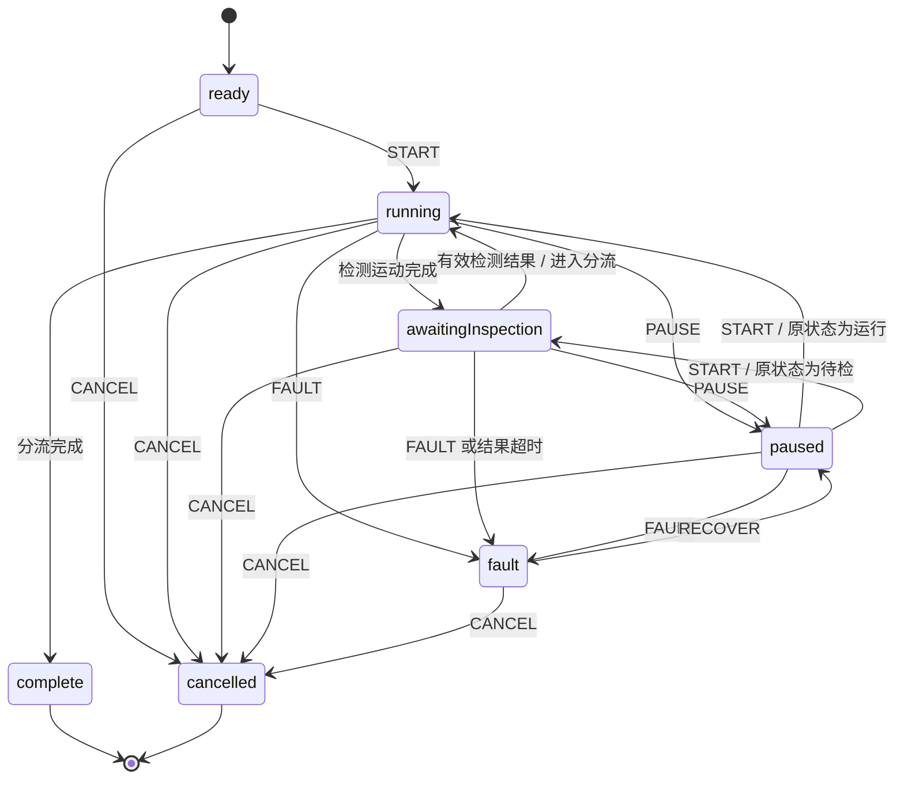

# v1.2 工序基础：第一项开发检查点

> 本文记录上一个独立工序模型检查点；后续已接入统一制造引擎，最新进展见《14-v1.2工序接入.md》。

历史 v1.0.0、v1.1.0、v1.1.1 已上传到 GitHub 私有仓库，并核对远端标签与原始发布包校验值后，才开始此分支开发。仓库：https://github.com/a18652062391-web/smartfactory-nexus 。

当前完成独立的 TypeScript 工序模型和验证，尚未连接旧版 Zustand 引擎、三维动画、排产或报表。应用发布版本仍为 v1.1.1；此分支是 v1.2 的开发检查点，不能据此宣称完整新版本已经交付。

## 模型与工艺

工件从投料开始拥有编号和订单关联，保存法兰配方版本、设备角色、参数快照、当前位置、阶段进度和加工轨迹。十九个阶段覆盖抓取、开门、定位、装夹、撤离、关门、端面/轮廓/钻孔/去毛刺、退刀、开门、夹持、松夹、卸料、关门、送检、检测和分流。时长和转速等参数为课程演示设定。

配方快照由 `src/simulation/process.ts` 提供；类型与可序列化上下文位于 `src/domain/process.ts`。工序定义直接包含执行设备角色、目标锚点和交接后持有位置。夹具夹紧时接管工件，卸料时由松夹完成移交夹爪。

锚点为 raw-pick、fixture-load、robot-clear、qc-place、output-place。本阶段只定义锚点语义，具体三维坐标和机械臂可达性在 P1 中确定。

## 状态与事件

| 状态 | 含义 |
|---|---|
| ready | 已建立身份及配方，等待开始 |
| running | 按当前工序推进 |
| paused | 工序和本地模拟时间冻结，保留恢复状态 |
| fault | 保留持有位置与进度，接收到的模拟时间继续记入等待 |
| awaiting-inspection | 检测运动完成，等待带测量值和规格的检测结果 |
| complete | 分流完成，位于良品或不合格暂存区 |
| cancelled | 已取消且停止推进，保留工件与记录 |

| 起点 | 事件与条件 | 结果 |
|---|---|---|
| ready | START | running，记录起始模拟时间 |
| running / awaiting-inspection | PAUSE | paused，记录暂停前状态 |
| paused | START | 返回暂停前状态，不重做完成工序 |
| running / awaiting-inspection / paused | FAULT | fault，保留位置、进度与原因 |
| fault | RECOVER | paused，清除当前故障，等待显式继续 |
| running | 时间跨过一般工序末尾 | 记录一次完成轨迹并进入下一阶段 |
| running 的 inspect 阶段 | 检测运动完成 | awaiting-inspection，尚不判定合格 |
| awaiting-inspection | 有效检测记录 | 根据所有测量值与允许范围判定结果，进入 sort |
| awaiting-inspection | 30 个模拟秒未收到结果 | fault，原因是检测结果等待超时 |
| running 的 sort 阶段 | 有检测结果且分流完成 | complete，进入相应暂存区 |
| 任意非终态 | CANCEL | cancelled，保留已有记录 |
| complete / cancelled | 命令、时间推进 | 忽略，不再产生业务结果 |

未列出的命令不改变状态。重复 START、PAUSE、RECOVER 不重新执行动作。首次开始前的设备可用性由未来加工单元协调器检查，ready 状态不响应单件加工故障事件。同编号且同内容的检测事件幂等，冲突内容拒绝覆盖。检测结果只在等待检测状态接收。



所有状态均可到达，非终态有显式出口，终态保持固定。检测外部输入有超时出口；本阶段不调用网络或硬件信号，不引入 actor 或后台定时器。

## 计数契约

统计从工件记录推导，不维护另一份递增计数。加工完成以退刀阶段完成为准；检测完成以有效测量记录为准；通过检测与最终进入良品暂存区分别计数。不合格件进入单独暂存区，不能记为良品。

良品暂存尚不等于合格入库或订单交付。本阶段没有新增交付计数，也没有修改旧版页面指标。后续加工单元、仓储和排产适配完成后，再按统一契约接入，避免混用新旧口径。

## 调用与存档

```typescript
const run = createProcessRun({ workpieceId: "WP-001", orderId: "ORD-001" });
commandProcess(run, { type: "START" });
advanceProcess(run, 5); // 由唯一的工厂模拟时钟提供秒数
const restored = restoreProcessRun(JSON.parse(JSON.stringify(run)));
// 运行中的有效存档恢复为 paused，显式 START 后继续。
```

上下文全部可序列化；没有引用 Canvas、Date、类实例、回调或真实计时器。权威来源为工厂模拟状态。计划使用浏览器持久化，当前模块仅实现快照恢复函数，尚未建立新的本地存储键或复制旧引擎。

恢复时检查版本、工序进度、设备、轨迹顺序、持有位置及检测值与判定的一致性。有效运行和待检状态恢复为暂停；故障和终态保留。旧版没有轨迹的记录不输入此恢复函数，也不凭空补造。

## 技能与后续范围

本次通过官方 skill-installer，将 definite-d/agent-skills 的 state-machine-design（提交 035a1418494b69d7390c29403c9aae2432527da3）安装到当前任务 `work/skills/state-machine-design`。读取完整 SKILL.md、实现选择指南、plain-typescript 与 testing 参考，采用状态、事件、恢复和幂等设计。未引入 XState 依赖。

本阶段检查：新增十三项工序测试，覆盖大/小时间步一致、交接归属、计数分离、公差边界、幂等、暂停、故障、检测超时、取消、JSON 恢复与损坏记录。实际执行 `npm test`：四个测试文件、三十项测试全部通过；`npm run build`：TypeScript 与 Vite 生产构建通过。本阶段没有界面接入，因此未将既有浏览器测试结果作为此次新动作的验证证据。

下一步：实现设备/缓冲资源协调、投料队列与订单统计适配，确定三维锚点坐标，再将这些工序状态连接到机械动作。质量参数的因果计算、独立回放、旧存档迁移与全页面指标适配仍按既定计划继续。
