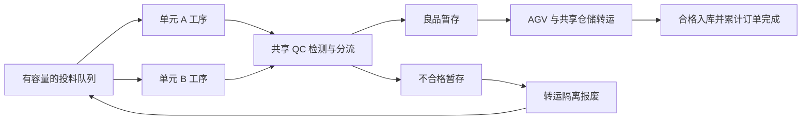

# v1.2 开发检查点：工序接入统一引擎

本次完成 P0 的下一步：将独立工序模型接入原有制造引擎、Zustand 状态、持久化与现有页面。开发在 develop/v1.2-process 分支进行，正式发布版本仍为 v1.1.1，尚未形成完整 v1.2 发布包。

## 实际行为

两组 CNC/机械臂单元使用十九阶段的演示工艺，共享 QC-01 与 ASRS-01，分别使用 AGV-01、AGV-02。每单元有两个待加工位、两个良品暂存位和两个不合格暂存位。投料按单元轮流分配，避免小订单被第一个单元全部预占。当前不同产品共用同一加工演示模板，产品配方差异属于后续扩展。

工件在投料时生成编号、订单关联和工艺/参数快照。设备占用由执行当前工序的资源、持有工件的资源和目标交接位共同决定。机械臂向检测站放置工件前就必须取得 QC 资源；任何时刻 QC 只能由一件工件持有。设备故障保留该工件和阶段进度，不会把进度转给另一个订单。

出料位满时，检测后的分流等待物流。物流设备停机时，上游会逐步受到缓冲容量限制。恢复物流后继续转运，原有工件编号和记录保持连续。

## 时钟、调度与计数

仅制造引擎推进模拟时钟。每次时间推进按工序边界、转运完成、计划开工与十秒采样边界切分；帧渲染不产生工件。运行模式缩放演示工序速率，同时保留实际模拟秒数，因此倍速、阶段进度和轨迹时刻能够对应。

新订单以合格入库件数满足需求为完成条件。加工完成在退刀时计数，生产检测合格在获得有效测量记录时计数，合格入库在转运结束时计数。不合格件隔离报废后按需求补投，不计入订单完成量。已完成与已投料数量共同约束新投料，防止过量派发。

取消订单撤销尚未加工的队列；正在处理的工件完成处置，保留身份和过程记录，后续入库不计为取消订单履约。修改订单数量不能低于当前已完成与已投料总数。

预计完工使用当前阶段剩余时间、队列、计划开工，以及共享检测和转运资源的排队占用。暂存中的良品和半途转运也纳入预测。已知工艺或物流路径停机时显示受阻，不给出该路径的确定完工时间。未来随机异常、临时故障及后续插单无法预知，预测按当前条件计算。

默认新场景的交付期限由原十秒抽象加工节拍调整到完整四十九秒工艺：三个初始订单交期分别为模拟开始后 7200、3600、12600 秒。旧存档中的用户订单交期保持原值。

## 检测与抽检

生产检测由参数与规格计算，不再单独随机抽取缺陷名称。第一条演示规则是孔位 X = 20.00 mm + 定位偏移，允许范围 19.95–20.05 mm；另记录外轮廓直径与尺寸补偿偏差。默认固定种子变化以六个百分点的概率在新投料件的定位偏移上增加 0.08 mm，再由测量值判定。所有数值是明确的演示设定，不构成真实工艺模型。

质量页可以查看检测值、允许范围和来源工序。抽检复用最近已检测工件，单独标为“抽检复核”，不创建新工件，不增加加工、生产检测件数或生产良品率。生产趋势和分线趋势使用实际加工/检测时刻，不使用投料时间提前计算产出。

## 存档升级与界面

模拟状态升级到 schema 2，继续使用原本地存储键与外观偏好。旧版订单的原完成数标记为历史加工完成数，并保存 legacyCompleted；旧的部分加工 carry 保存为 legacyCarry，不补造缺失的工件身份、加工轨迹或入库记录。新增部分按合格入库计算。运行中的新存档恢复为暂停，转运中的工件保留转运进度。

保存时将相同的工艺定义归并到配方目录，每件工件仍保存独立参数与轨迹，恢复时还原独立配方对象。完整默认批次的 UTF-16 存储估算由 5,684,558 字节降到 4,036,084 字节，减少约 29%；真实 Chrome 验证了全部 370 件订单、389 次投料及工序轨迹可写入并刷新恢复。

设备详情显示当前工件、产品、工序进度、工件持有位置、队列/缓冲容量与等待原因。排产、总览和报告区分加工完成、在制和合格入库。最大字号与主题色继续遵循既有设置。

当前三维机械形体仍使用上一阶段的演示动作。工序模型已经提供驱动真实取放、机床门和刀具动作的数据，但本次未将十九阶段转换为机械关节和刀具动画。

## 验证范围

单元检查覆盖：投料边界、身份唯一、共享 QC 无检测重叠、物流反压与恢复、异常参数快照与补投、抽检计数、故障后进度保留、大小时间步一致、采样唯一、半途转运恢复、旧存档迁移与取消订单。

时间回归同时检查单单元及双单元在标准、高性能、节能模式下的预计完工稳定性，以及固定的实际入库完成时间。浏览器检查覆盖当前工序显示和刷新恢复、超差测量追溯、抽检不增产，以及原有主题、字号、移动布局、生产/维修/报告和 AR 流程。

实际执行：`npm test` 五个测试文件、44 项检查通过；`npm run test:e2e` 16 项通过、无失败、跳过或重试；`npm run build` 的 TypeScript 与 Vite 生产构建通过。验证摘要见 deliverables/flow-validation.json。

真实浏览器 inspector 对生产构建的 1440、768、390 像素视口检查：0 FAIL、3 WARN，三种宽度均无页面横向溢出。警告为既有品牌大写小字、系统字体回退检测、默认密集字号；保留品牌和可调字号设置，未将其计为布局失败。报告与截图位于 deliverables/ui-inspection-flow-production/。

新增截图：deliverables/screenshots/v1.2-flow-device.png、v1.2-flow-device-mobile.png、v1.2-flow-inspection.png。截图显示真实浏览器页面，三维运动的几何正确性仍需后续 P1 验证。

下一步：确定取放锚点与机械臂可达布局，按十九阶段实现抓取、装夹、机床门和刀具动作，再增加设备内部观察与独立回放。
